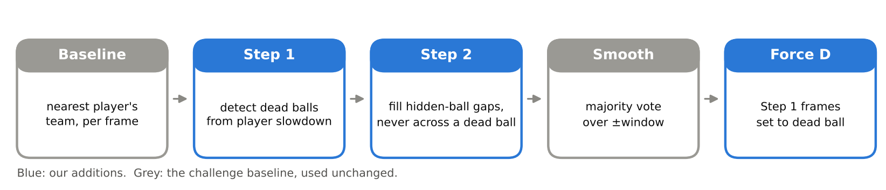
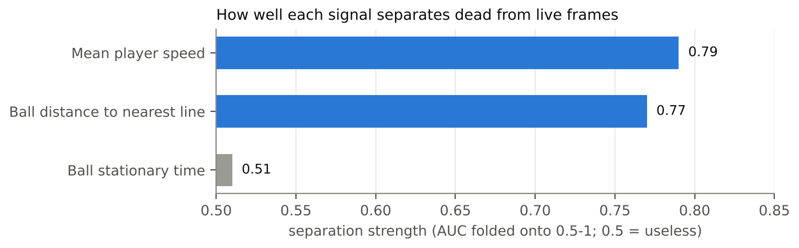
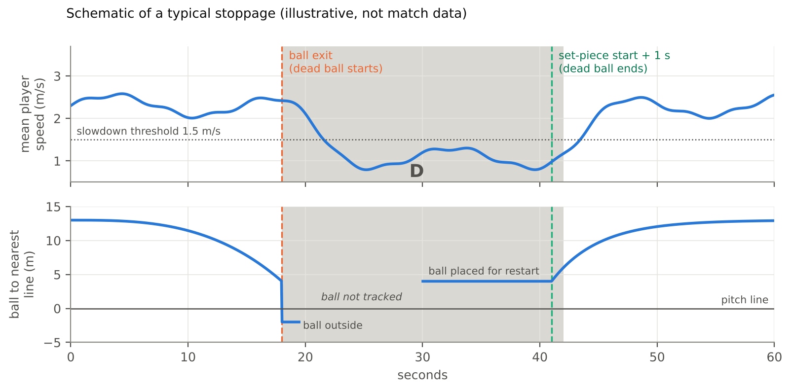
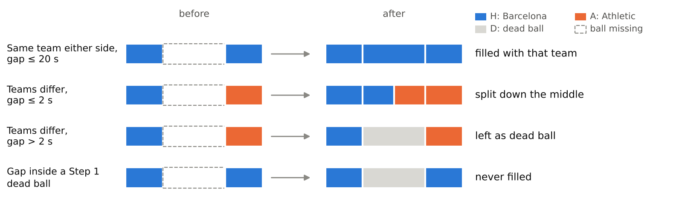
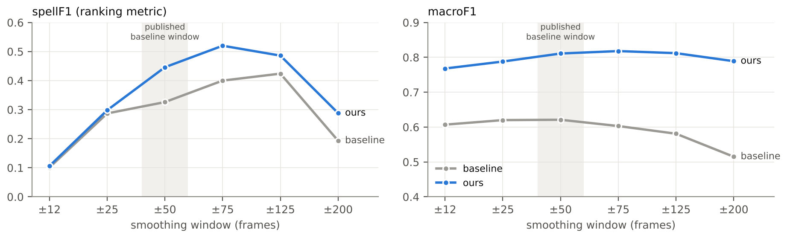
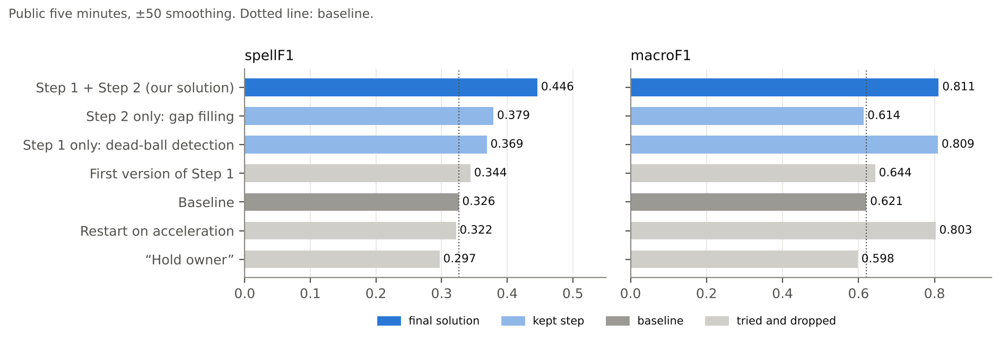

# Who has the ball? Technical document

**Team:** Athletica Intelligentia
**Challenge:** More Than A Hack, possession labelling
**Match:** FC Barcelona (home, `H`) vs Athletic Club (away, `A`), 25 fps, 199,319 frames (158,857 graded)

---

## 1. Summary

We label every frame of the match `H`, `A` or `D` (dead ball). We start from the challenge baseline and add two
rule-based steps, each motivated by what the data shows:

1. **Dead-ball detection.** Find stoppages from how the *players* move, not only from whether the camera can see the ball.
2. **Gap filling.** When the ball is hidden during live play, give it to the team that clearly had it before and after.

There is no machine learning and no training. Every step is a readable rule over the tracking data and the Smart
Tagging events, and every threshold is a named setting at the top of `solution/run_inference.py`.

At the published ±50 smoothing window, on the public five minutes, **spellF1 rises from 0.326 to 0.446 and macroF1
from 0.621 to 0.811**. Dead-ball recall goes from 0.21 to 0.84. Our solution beats the baseline on both metrics
at every smoothing window we tested.



---

## 2. The approach, and why

### 2.1 The baseline's weak spot is the dead ball

The baseline gives each frame to the team of the player nearest the ball, says `D` whenever the ball is not visible,
and smooths with a majority vote. It gets the team right most of the time, but finds only **21% of dead-ball frames**.
Since macroF1 weights `H`, `A` and `D` equally, and dead balls are what separate possessions in spellF1, this is
where the points are.

The baseline's assumption that "ball missing = dead ball" fails in both directions on the public ground truth:

- **Two thirds of real dead-ball time has the ball visible.** The ball is out of play or being placed for a restart
  but still tracked, so the baseline calls it possession.
- **Almost half of the missing-ball frames are live play.** The ball is hidden behind players or in the air, so the
  baseline calls it dead.

Our two steps each fix one of these failures.

### 2.2 Why player speed, and not the ball

We measured candidate signals against the public ground truth, asking how well each one separates dead frames
from live ones (AUC, where 0.5 is useless):



- **Players slow down together** when play stops. Mean player speed roughly halves, from about 2.3 to 1.2 m/s. It
  is the strongest signal, and it does not need the ball to be visible.
- **Dead balls happen near the lines.** The ball is about 4 m from a line when play is dead, against 13 m in live play.
- **A stationary ball tells us nothing.** During a stoppage the ball is carried, thrown back or rolled into place,
  rarely still.

Lining up all 59 Smart Tagging set pieces on their start time showed that the **start of a set piece is the
restart**: players are slowest exactly then and accelerate within seconds. The ball usually left play 10-30 s
earlier. That gave the shape of a dead ball: *from the ball leaving play, to the restart*.



Two of the four stoppages in the public window have no ball exit and no set piece (fouls, injuries), but they
still show the slowdown. So player speed became the backbone of Step 1, and exits and set pieces became the
evidence that confirms a slowdown is a real stoppage.

### 2.3 Why rules rather than a model

The only ground truth available is five minutes long, with 17 possessions. That is too little to train or
validate a learned model without overfitting. Rules built from measured signals can be read, checked and stress-tested
(Section 5 shows the results barely move when the thresholds change), and they transfer to the rest of the match
without needing labels.

---

## 3. Assets: what we used, and what we dropped

| asset | used? | how |
|---|---|---|
| **Tracking (ATD): ball position** | ✅ | Nearest-player rule; ball speed; distance to the nearest line; ball exits. Missing on ~41% of graded frames |
| **Tracking (ATD): player positions and teams** | ✅ | Nearest player to the ball (baseline) |
| **Tracking (ATD): player speeds** | ✅ | Mean speed of all tracked players, smoothed over 1 s: the backbone of Step 1 |
| **Smart Tagging: set-piece start times** | ✅ | Marks the restart, which ends a dead ball. 59 in the match |
| **Smart Tagging: set-piece intervals** | ❌ | A fixed ~35 s that mostly covers live play after the kick. Only the start is useful |
| **Smart Tagging: Team tag** | ❌ not tried | Noisy, and missing on every throw-in. Listed as a future idea |
| **Public ground truth (first 5 minutes)** | ✅ | Measuring signals and checking each step. Never used to fine-tune thresholds |
| **Challenge code** (`starter/`, `evaluation/`, `games.py`) | ✅ | Used unchanged: the baseline, the official scorer |

Smart Tagging is automatic and incomplete: it lists only 26 throw-ins for the whole match, and only about 60% of ball
exits are followed by a tagged set piece within 60 s. That is why it serves as supporting evidence, never as the
main signal.

---

## 4. Possession rules

### 4.1 Who has the ball (live play)

- **Visible ball:** the team of the tracked player nearest the ball has it. This is the baseline rule, used unchanged.
- **Loose balls and the ball in the air:** these also go to the nearest player's team. We tried a "hold owner" rule,
  keeping the last team when nobody is within 3 m of the ball. It scored worse (spellF1 0.297) and only helped at a
  ~1.5 m distance tuned on five minutes, so we dropped it.
- **Challenges and 50/50s:** not modelled separately. Brief flicks between teams during a contest are absorbed by
  the majority-vote smoothing. Possession changes once one team holds the ball for most of the window.

### 4.2 When the ball is dead (Step 1)

A **dead ball** is a stretch where the players slow down together, supported by evidence that play stopped.

| rule | setting | why |
|---|---|---|
| **Slowdown:** mean player speed stays below a threshold for a minimum time | < 1.5 m/s for ≥ 3 s | Between the dead (1.2) and live (2.3) levels. Results barely change from 1.2 to 1.8 m/s |
| **Ball exit:** ball seen outside the pitch, or lost near a line. Exits less than 5 s apart count as one | > 0.5 m outside / lost within 2 m / 5 s | Small margins absorb tracking noise |
| **Anchor:** an exit up to 15 s before the slowdown, or a set-piece start inside it or up to 5 s after | 15 s / 5 s | Exits typically come 10-30 s before the restart |
| **Start:** the ball exit, if there is one; otherwise the start of the slowdown | | The dead ball begins when the ball leaves play, not when players react |
| **Restart (end):** the set-piece start + 1 s; otherwise the end of the slowdown | 1 s | Waiting for players to speed up scored worse: by then a team already has the ball |
| **Unanchored slowdown:** no exit, no set piece, but slower and longer. Fouls and injuries | < 1.2 m/s for ≥ 5 s | Stricter because there is no other evidence. Lifts dead-ball recall from 0.52 to 0.84 |

Dead-ball frames are **forced to `D` after smoothing**, so the majority vote cannot overrule them.

### 4.3 When the ball is hidden (Step 2)

A **gap** is a run of frames inside one half where the ball is missing and Step 1 found no dead ball. The team on
each side is the majority team in the second before and the second after the gap.



| case | rule | why |
|---|---|---|
| Same team either side | Fill with that team, up to **20 s** (8 s × 2.5) | Most gaps last 5-30 s; 20 s is the mid-point of the range we compared |
| Teams differ, gap ≤ 2 s | **Split down the middle** | The hand-over happened inside the gap; only short gaps can be split safely |
| Teams differ, gap > 2 s | Leave as `D` | We cannot tell when the ball changed hands |
| Gap inside a Step 1 dead ball | **Never filled** | That gap is a stoppage, not a hidden ball |

### 4.4 Smoothing

Finally, the baseline's majority vote over ±window frames, for windows from ±12 (0.5 s) to ±200 (8 s). One
submission is written per window. Step 1 frames are then set back to `D`.

---

## 5. Results

Scored with the official scorer against the public ground truth (the first five minutes of the match).



| smoothing window | spellF1 baseline | spellF1 ours | macroF1 baseline | macroF1 ours |
|---|---|---|---|---|
| ±12 | 0.101 | 0.106 | 0.607 | 0.768 |
| ±25 | 0.287 | 0.298 | 0.620 | 0.788 |
| **±50 (published baseline)** | **0.326** | **0.446** | **0.621** | **0.811** |
| ±75 | 0.400 | 0.520 | 0.603 | 0.818 |
| ±125 | 0.424 | 0.486 | 0.581 | 0.812 |
| ±200 | 0.193 | 0.288 | 0.515 | 0.789 |

Dead-ball F1 at ±50 rises from 0.32 to 0.78.

### 5.1 What each step contributes, and what we dropped



- **Step 1** gives almost all of the macroF1 gain, because dead balls go from mostly missed to mostly found.
- **Step 2** on its own makes possessions fewer and longer, which helps spellF1. But it lowers dead-ball recall,
  because it fills some real stoppages. That is why it runs after Step 1.
- **Together** they help spellF1 much more than either alone: Step 1 puts possession boundaries in the right place,
  and Step 2 stops possessions breaking up every time the ball is hidden.

| tried and dropped | result | why |
|---|---|---|
| Interpolating the ball across short gaps | no change | Recovered 0.1% of missing frames: almost every gap is longer than 4 s |
| "Hold owner" when nobody is within 3 m | 0.297 / 0.598 | Worse. Only helped at ~1.5 m, a value tuned on five minutes |
| First version of Step 1 (ball vanished near a line, or ball still) | 0.344 / 0.644 | Found only 28% of dead-ball time: two thirds of it has the ball visible |
| Stationary ball as a stoppage signal | no separation | During stoppages the ball is carried or rolled back |
| Set-piece intervals as `D` | not used | Mostly live play after the kick |
| Corner zone (ball near a corner flag = corner being set up) | no effect | The tracker sees the ball near a corner flag for only ~4 s all match |
| Restart on acceleration | 0.322 / 0.803 | Players are still slow after the kick, when a team already has the ball |

*Scores are spellF1 / macroF1 at ±50.*

> **A word of caution.** The public window holds only 17 possessions. One missed possession moves spellF1 by
> about 0.06. Treat these numbers as evidence that the method works, not as a precise ranking of windows or settings.

---

## 6. Limitations, and what we would fix with more time

**Slow build-up looks like a stoppage.** At every window, home-team recall is about 0.02-0.03 below the baseline
(0.859 vs 0.880 at ±50). Almost all of the loss is Barcelona possession being called dead. Our hypothesis is that
Barcelona's slow, patient circulation at the back, with players barely moving, looks like a stoppage to a rule built
on player speed. *Fix:* add a signal that tells slow play from stopped play, such as whether the ball keeps moving
between teammates.

**False ball exits.** A ball that vanishes near a line is not always out of play. One false exit in the public window
creates a wrong 10-second dead ball. *Fix:* require the ball to stay unseen, or the players to slow, before trusting
an exit near a line.

**Smart Tagging is incomplete.** It misses many restarts (only 26 throw-ins tagged). Missing restarts fall back on the
stricter unanchored rule, so some short stoppages are missed.

**Challenges are not modelled.** 50/50s and tackles are left to the nearest-player rule and smoothing. Fast
turnovers can lag by up to half a smoothing window.

**We cannot confirm the full-match dead-ball share.** We label about 46% of the whole match as dead, against 20% in
the public five minutes. Professional matches typically have 52-55 minutes of real playing time, so 40-45% dead is
plausible, and the opening minutes had few stoppages. It cannot be confirmed without the full ground truth.

**Small validation sample.** Five minutes cannot reliably separate two good settings. The best-looking window on
the public data may not be the best over the full match.

**Ideas not yet tried:**

- **Team shape when the ball is missing:** the team in possession spreads out and the defending team compacts.
- **Smart Tagging's Team tag** as a prior on who has the ball.
- **A minimum possession length** inside the smoothing step, to stop very short false possessions.

---

## 7. Reproduction

The match data is gated and is not in the repository. See `DATA.md` for how to obtain it, and unpack it into `data/`.

```bash
uv sync                                    # install dependencies
uv run python solution/run_inference.py    # write submissions, score them, print the comparison
./solution/clean.sh                        # remove everything run_inference.py produces
```

`run_inference.py` computes the baseline's nearest-player answer with the challenge's own code, applies Step 1 and
Step 2, then writes and scores one submission per smoothing window:

| output | content |
|---|---|
| `evaluation/results/athletica_intelligentia_smooth_<window>.csv` | One submission per smoothing window |
| `evaluation/scoreboard.csv`, `evaluation/reports/*.json` | Official scores from `evaluation/run_evaluation.py` |
| `evaluation/reports/athletica_intelligentia_config.json` | The exact settings used for the run |

To experiment, change a setting at the top of `solution/run_inference.py` (for example `STOP_PLAYER_SPEED` or
`GAP_FILL_MULTIPLIER`), or switch a step off in `PIPELINE`. `solution/walkthrough.ipynb` walks through the data
analysis behind every rule and re-runs each comparison in this document.
